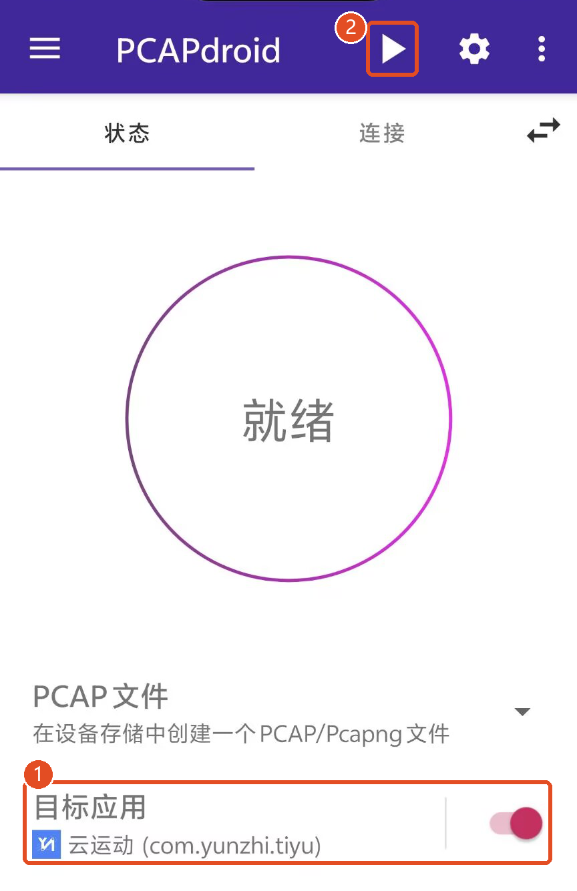
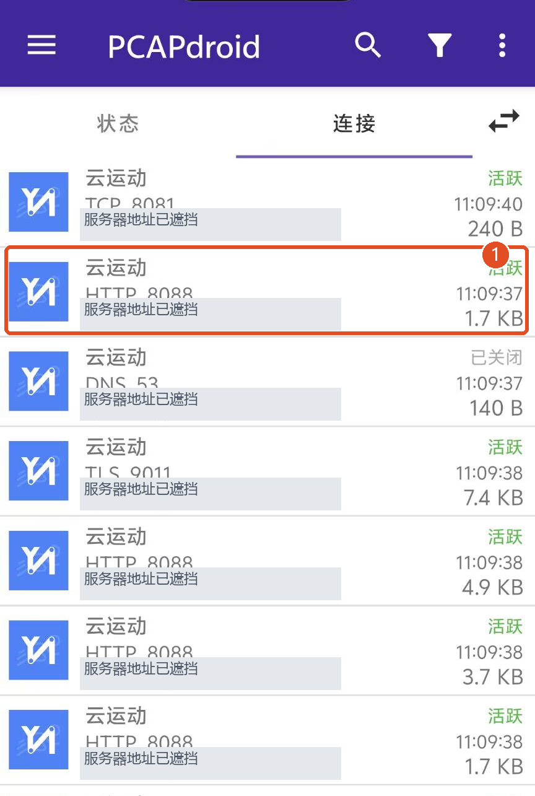
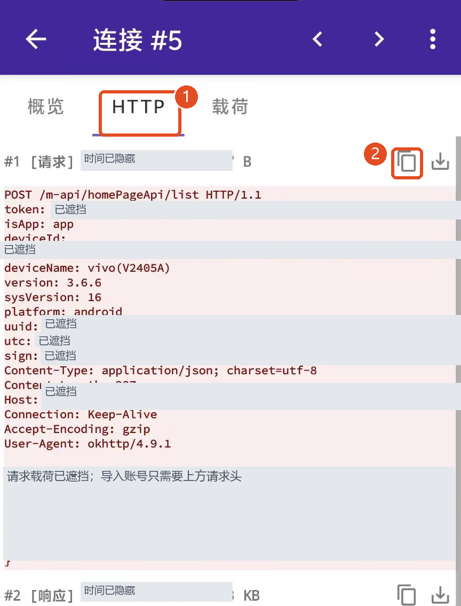
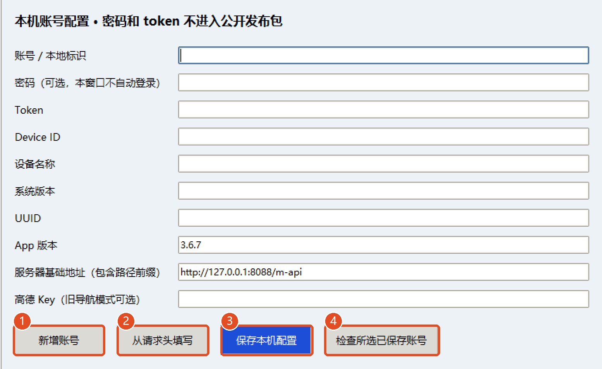
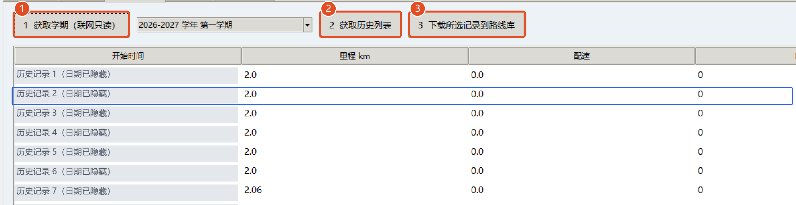

# 图文上手教程：PCAPdroid → 账号 → History → 路线预览

从手机捕获自己的登录请求，到电脑保存账号、下载历史路线，再完成参数预览。配图均为实际操作截图，已标注点击位置并遮挡登录信息。

> 图中界面均为实际操作截图；红框和编号标出点击顺序，敏感登录信息已遮挡。不同版本的布局可能略有差异。

## 开始前：打开电脑端 GUI

首次下载后，安装 Python 并在项目目录执行 `setup.ps1` 安装依赖，再双击 `start_gui.bat`。详细安装步骤见 [主说明](../README_DESKTOP.md)。

手机和电脑之间只需传递自己的请求头文本；不要把它贴进公开仓库、教程截图或公开 issue。

## 1. 安装 PCAPdroid，目标应用设为云运动

手机安装 [PCAPdroid 官方版本](https://github.com/emanuele-f/PCAPdroid/releases/latest)。在 Releases 页展开 Assets，下载 APK；安装操作在手机上自行完成。

打开 PCAPdroid 的“状态”页，点击“目标应用”。在应用列表中只打开“云运动”的开关（图中①），核对包名 `com.yunzhi.tiyu`，再返回状态页。

## 2. 开始捕获，再回云运动刷新首页

先确认“目标应用”为云运动（图中①），再点击“状态”页右上角三角形 `▶` 开始（图中②）。首次运行出现 Android VPN 提示时，确认的是 PCAPdroid 在本机捕获流量。

切到已登录正确账号的云运动，进入首页或跑步首页，等待加载完成；随后返回 PCAPdroid。“只复制请求头”不必开启一次实际跑步，也不必导出 PCAP 文件。

## 3. 在“连接”里找到 HTTP 8088

切换到“连接”，找到“云运动 / HTTP, 8088”这一类记录并打开（图中红框①）。不要选成 TCP 8081、DNS 53 或 TLS 9011。

8088 是本教程对应环境的示例端口，不是所有学校通用规则；服务器地址和端口以你自己的 App 请求为准。列表中没有时，保持捕获开启并回云运动刷新页面。

## 4. HTTP → #1 请求 → 复制两者

进入连接详情的“HTTP”页（图中①），找到第一条合适的 `#1 [请求]`，点击这一项右侧的复制图标（图中②）。出现菜单时选择“复制两者 / Both”（请求头 + 请求载荷），不同版本文案可能略有不同。

**关键是包含请求头、并且 `token:` 后有内容。** 不要复制 `#2 [响应]`，不要选 `/login/...` 中 token 为空的登录请求。GUI 不需要你解密 `cipherKey` 或 `content`。

当前导入器只读取请求头，所以“仅复制请求头”也可用。如果提示“载荷被截断”且你还需要正文：先停止捕获，在状态页右上角齿轮设置里开启“完整载荷”，再重新抓一次；旧数据不能补回。

## 5. GUI 账号管理 → 从请求头填写 → 保存

电脑打开 GUI，进入“账号管理”。新账号先点“新增账号”（图中①），手动填“账号 / 本地标识”，确保知道本次请求属于哪个账号；更新已有账号则先从顶部列表选中它。

点击“从请求头填写”（图中②），粘贴手机复制的整段请求，点击弹窗中的“填写到表单（尚未保存）”。检查 Token、设备、App 版本、UUID 和服务器地址，再点“保存本机配置”（图中③）。

点击“检查所选已保存账号”（图中④）或顶部“认证检查（只读）”。认证成功后才继续。请求头中没有学号或密码，工具不会自动推断所属账号；密码可以留空。模板地址 `127.0.0.1` 只是占位值，应由你自己的请求头填写实际地址。

## 6. History：获取学期 → 获取列表 → 下载所选记录

在 GUI 顶部确认当前账号，进入“History 记录”。依次点击“1 获取学期（联网只读）”，选学期，再点“2 获取历史列表”。

在列表中点选一条自己已完成的历史路线，点击“3 下载所选记录到路线库”。下载结果保存在本机 `tasks_else`，并会进入路线库。

某些服务器的列表接口会把配速或时长返回为 0，不代表详情中的路线数据也是 0。以下载后的详情和“路线与预览”摘要为准。下载失败时先查看执行日志。

## 7. 路线与预览：选路线、调参数、再执行

回到“路线与预览”，点击刷新。选择“使用下方选中的已有路线”，再点选刚下载的文件；也可以选择从 `tasks_else` 目录随机选取连续路段。

选择 `run` 跑步或 `walk` 走路数据模式。总长度默认 2 km；跑步默认平均配速 5～7 分/km、步频 170；走路默认平均配速 9 分/km、步频 120，总时长约 18 分钟。参数都可在窗口调整。

先点“02 生成本地副本与预览”，核对路线几何、配速变化、距离、时长和账号。修改任何参数后都需要重新生成。这个按钮只生成本地文件。

需要执行已获授权的服务器测试时，再点“03 提交当前预览的数据”，核对弹窗中的账号、地址、里程和时长后确认。此操作会创建服务器记录；认证失败或网络中断后先检查未完成记录，不要直接反复新建。

## 参考路线如何获取

优先从当前账号的 History 下载自己的路线，这样来源和场地更明确。已有 history/tasklist JSON 也可通过“导入 history JSON”直接加入路线库。

仓库提供两份 [人工演示路线](../demo_routes/README.md)：[演示路线 A](../demo_routes/tasklist_9.json)、[演示路线 B](../demo_routes/tasklist_6.json)。在 GitHub 点击文件后使用 Raw / Download raw file 保存，再导入 GUI；下载整个仓库时已包含这两个文件。

**演示路线仅用于离线预览和格式测试**：坐标在 (0,0) 附近，不是校园实地路线，没有有效踩点，不能当作适合直接提交的校园参考路线。公开包未包含任何人的真实 history。

## 常见问题

### 没有找到 8088

确认目标应用是云运动，先开始捕获，再回 App 刷新。端口可能随学校或版本变化，以自己的抓包为准。

### 复制后没有自动填

应复制 #1 请求的请求头。只复制加密正文或 #2 响应无法填写账号；先看 token、deviceId、Host 等行是否存在。

### 认证失败 401

保存的凭据无效。正常登录对应账号后重新抓请求头、保存配置，再做只读认证检查；退出或切换账号可能使旧 token 失效。

### 历史列表显示 0 配速 / 0 秒

有些服务器列表接口省略这些值。下载记录详情后再查看实际点位、时长和配速，不需要手工把 0 改掉。

### 路线不足 2 km

选择坐标长度足够的源路线，或按测试需求调整目标长度。工具不会把短路线凭空补成 2 km。

### 跑到一半断线或时间突然很长

保持电脑开盖、网络稳定，不要中途手动休眠。空闲睡眠保护不覆盖合盖设置；失败后查看日志和服务器未完成记录。

## 官方参考

- [PCAPdroid 官方下载](https://github.com/emanuele-f/PCAPdroid/releases/latest)
- [PCAPdroid 官方基本用法](https://emanuele-f.github.io/PCAPdroid/quick_start.html)

文档整理：2026-11-13。手机步骤参考用户提供的 PCAPdroid 2.x 界面及官方文档；GUI 按本仓库实际按钮名称编写。
